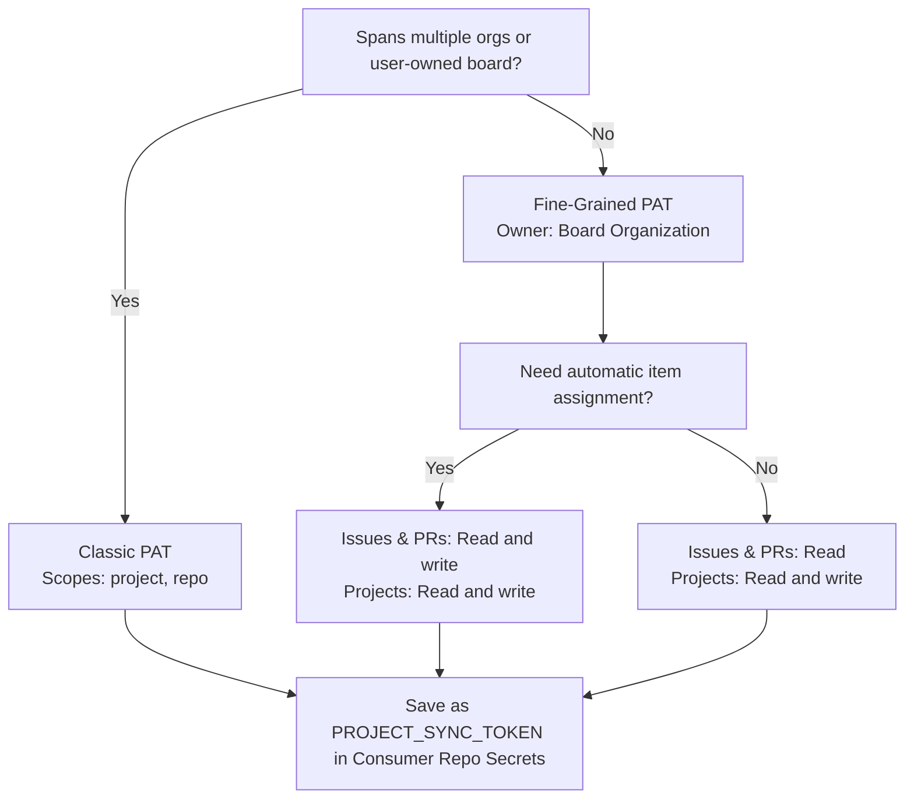

# Project Sync

[](https://nodejs.org/)
[](https://nodejs.org/api/esm.html)
[](#stability--predictability)

**Project Sync** is a high-performance GitHub Projects v2 automation engine designed to synchronize issues and pull requests across complex, multi-repository organizations with 100% predictability.

## Overview

This tool transforms your GitHub Project into a self-driving productivity engine. It eliminates manual board maintenance by implementing a rule-based state machine for:

- **Intelligent Intake**: Automatically adds PRs and issues to the project board based on authorship, assignment, or repository source.
- **Dynamic Workflows**: Moves items between columns (e.g., `New` → `Active`) based on real-time state changes.
- **Sprint Orchestration**: Seamlessly manages sprint assignments and rollovers.
- **Smart Inheritance**: Propagates PR metadata (sprints, columns, and the author as assignee when a monitored user wrote the PR) to linked issues.
- **Multi-Org Mastery**: Monitors activity across `bcgov` and `bcgov-c` simultaneously.

## Usage as a GitHub Action

You can consume Project Automator as a standalone GitHub Action in your own consumer repository:

```yaml
name: Project Sync

on:
  schedule:
    - cron: "17 * * * *" # Hourly (staggered to avoid top-of-hour load drops)
  workflow_dispatch:
    inputs:
      catch_up:
        description: 'Catch up: add all missing open items'
        required: false
        default: false
        type: boolean
      dry_run:
        description: 'Dry run: execute in read-only mode'
        required: false
        default: false
        type: boolean

permissions: {}

concurrency:
  group: ${{ github.workflow }}-${{ github.event_name }}-${{ github.ref }}
  cancel-in-progress: true

jobs:
  sync:
    name: Sync Board
    runs-on: ubuntu-26.04
    timeout-minutes: ${{ inputs.catch_up && 60 || 5 }}
    permissions:
      contents: read
    steps:
      - name: Checkout Rules
        uses: actions/checkout@<checkout-release-sha> # v7.0.1

      - name: Run Project Automator
        uses: bcgov/project-automator@<release-commit-sha> # vX.Y.Z
        with:
          github_token: ${{ secrets.PROJECT_SYNC_TOKEN }}
          config_path: rules.yml
          dry_run: ${{ inputs.dry_run || false }}
          backfill: ${{ inputs.catch_up && 'all' || '' }}
          verbose: 'true'
```

Always pin the action to a full 40-character release commit SHA rather than a floating tag (such as `@v1`). Floating tags can be retargeted or mutated, introducing unexpected behavioral changes or supply-chain risks into scheduled workflows. Release SHAs are published in each [GitHub Release](https://github.com/bcgov/project-automator/releases).

### Action Inputs

| Input | Required | Default | Description |
| :--- | :--- | :--- | :--- |
| `github_token` | **Yes** | `github.token` | Personal access token that can read and write the project board and read the monitored repositories. The default Actions token has no Projects access, so the run fails until you set this. A `GITHUB_TOKEN` environment variable never replaces it. See [Authentication & Token Setup](#authentication--token-setup). |
| `config_path` | No | `rules.yml` | Path to rules configuration file in the repository. |
| `dry_run` | No | `false` | Run in read-only mode without mutating board items or watermarks. |
| `backfill` | No | `''` | Backfill window for open items: `30d`-style or `all`. |
| `verbose` | No | `true` | Enable verbose log output. |

## Automated Noise Exclusions

To prevent automated noise and metadata artifacts from cluttering the project board, the engine early-skips issues and pull requests matching specific titles or labels before applying rule transitions.

### Default Exclusions
By default, the engine excludes:
- **Dependency Dashboard** (Exact Match): Excludes Renovate or Dependabot organization-wide interactive dashboards.
- **ZAP Security Report** (Substring Match): Excludes automated vulnerability and security scan reports.
- **ZAP Full Scan Report**, **ZAP Scan Baseline Report**, **ZAP API Scan Report** (Substring Match): Exclude issues opened by the ZAP GitHub Actions (`zaproxy/action-full-scan`, `action-baseline`, `action-api-scan`) under their default titles, and titles that extend them (e.g. `ZAP Full Scan Report: <url>` from `bcgov/actions/scan-url`).
- **ZAP: ** (Prefix Match): Excludes ZAP reports opened with a custom `issue_title` such as `ZAP: <name>` (e.g. `ZAP: backendPy` from `bcgov/quickstart-openshift-modules`).

### Custom Exclusions
Teams can customize exclusions in their `rules.yml` to filter out specific automated noise:

```yaml
# Exclusion rules to filter out automated noise by title
exclusions:
  exact_titles:
    - "Dependency Dashboard"
    - "My Custom Noise Title"
  title_substrings:
    - "ZAP Security Report"
    - "ZAP Full Scan Report"
    - "ZAP Scan Baseline Report"
    - "ZAP API Scan Report"
    - "[Automated]"
  title_prefixes:
    - "ZAP: "
  exclude_labels:
    - "do not track"
```

Strings checked against `exact_titles` must match the issue or pull request title exactly (trailing/leading whitespaces and carriage returns are automatically trimmed before evaluation). Strings in `title_substrings` will exclude any item containing that substring, and strings in `title_prefixes` will exclude any item whose title starts with that prefix. Title matches are case-sensitive. An item carrying any label in `exclude_labels` is skipped; label names must match whole, ignoring case, as GitHub treats label names. The three title lists are required in `rules.yml`; there are no built-in defaults. `exclude_labels` is the one optional key: when it's absent, no labels are excluded (`[]`), so configs written before it keep working. Like title exclusions, a label exclusion skips the item on every run, so it isn't added, moved or assigned; it isn't removed from the board if it's already there. Title and label exclusions also apply to the issues a PR closes, so an excluded issue isn't moved, given a sprint or assigned through its PR.

### Author exclusions

Two optional keys skip items by who opened them, such as dependency bots, so routine updates don't count as sprint work:

```yaml
exclusions:
  authors:
    - renovate[bot]
    - dependabot[bot]
    - mend-bolt-for-github[bot]
    - mend-for-github-com[bot]
  unless_review_requested: true
```

`authors` lists GitHub logins, matched ignoring case; bots use their full login with the `[bot]` suffix. Renovate run by Mend opens PRs as `renovate[bot]`. An issue or PR by a listed author is skipped like any other exclusion. With `unless_review_requested: true`, a PR by a listed author is still added when a monitored user is a requested reviewer, so a bot PR that needs a person's attention still reaches the board. Both keys are off when absent (`[]` and `false`), and the engine has no built-in author list. Nothing already on the board is removed.

`github-actions[bot]` is deliberately not listed: workflows use it to open real report PRs (for example in `bcgov/action-repo-reporter`), so excluding it would hide work. The trade-off is that any routine PR a workflow opens as `github-actions[bot]` still reaches the board. The title exclusions above stay as a fallback for bot issues such as the Dependency Dashboard and ZAP reports.

## Stability & Predictability

We treat stability as a first-class feature. Our "Ludicrous Testing" philosophy ensures that every rule processed is verified against a comprehensive matrix of conditions.

- **Hardcoded Validation**: We use a strict whitelist-based validator to ensure rule evaluation is 100% predictable and secure against code injection.
- **Native Efficiency**: Built on **Node.js 24** and native **ES Modules** for lightning-fast, future-proof execution.
- **Zero-Network Tests**: Our 240+ count test suite runs in pure isolation, guaranteeing that the core logic is bulletproof without ever making a real API call.
- **Strict Environments**: We enforce Node versions via `.npmrc` to ensure that every developer and CI runner is perfectly aligned.

## Visibility & Auditing

Designed for transparency. Every run provides:

- **GitHub Actions Job Summary**: A premium Markdown report generated in the Action's summary tab.
- **Audit Logs**: Detailed console output with a `[AUDIT]` prefix for all state transitions.
- **Precision Metrics**: Real-time counters for processed, added, and skipped items.

## Consumer Setup

Run this action from your own dedicated consumer repository, which holds your `rules.yml`, your workflow, and your token secrets. This engine repository provides the reusable action logic and an example [`rules.yml`](rules.yml).

### Step-by-Step Consumer Quickstart

Follow these 5 steps to configure automated synchronization for your GitHub Project:

1. **Create a Dedicated Consumer Repository**:
   Create a repository (e.g. `your-org/project-sync`). Using a private repository is strongly recommended to protect board metadata, repository scopes, and workflow secrets.
2. **Add `rules.yml`**:
   Copy [`rules.yml`](rules.yml) into the root of your consumer repository (or into `boards/<name>.yml` for multi-board setups). Customize:
   - `project.url`: Your GitHub Project (v2) URL (e.g. `https://github.com/orgs/my-org/projects/1`).
   - `project.organization`: Default organization for unqualified repository names.
   - `project.allowedOrgs`: Organizations to query for user-scoped items.
   - `automation.repository_scope.repositories`: Repositories whose open items are synced unconditionally.
   - `automation.user_scope.monitored_users`: Logins whose authored, assigned, or review-requested items are tracked.
   - `board_columns` & `sprints`: Status columns and active sprint assignments.
3. **Generate & Configure Token Secret (`PROJECT_SYNC_TOKEN`)**:
   Choose the required token type (see [Interactive Token Setup Walkthrough](#interactive-token-setup-walkthrough)):
   - **Single Organization**: [Fine-Grained PAT](https://github.com/settings/personal-access-tokens/new) (`Projects: Read and write`, `Issues: Read and write`, `Pull requests: Read and write`).
   - **Multi-Organization or User Boards**: [Classic PAT](https://github.com/settings/tokens/new?scopes=project,repo&description=PROJECT_SYNC_TOKEN) (`project` and `repo` scopes).
   Save the token in your consumer repository under **Settings** → **Secrets and variables** → **Actions** as `PROJECT_SYNC_TOKEN`.
4. **Set Up Workflow (`.github/workflows/sync.yml`)**:
   Add [`.github/workflows/sync.yml`](#usage-as-a-github-action) with your staggered cron (e.g. `17 * * * *` to avoid top-of-hour drops) and `workflow_dispatch`. Pin `bcgov/project-automator` to its full 40-character release commit SHA.
5. **Verify and Catch Up**:
   - Merge your initial pull request to your repository's default branch (`main`) first, as GitHub Actions only exposes `workflow_dispatch` triggers that exist on the default branch.
   - Run an initial verification via **Actions** → **Sync** → **Run workflow** with `dry_run: true`.
   - Inspect the job log: verify that the startup access report confirms access to the project board and all monitored repositories (`Access: ...: OK`).
   - Run workflow dispatch with `catch_up: true` once to backfill any existing open issues and pull requests onto the board.

### Sample AI Agent Prompt

You can copy and paste this prompt directly into an AI coding assistant (such as GitHub Copilot, Cursor, or Claude) to set up and verify a dedicated consumer repository:

```text
Set up a consumer repository for GitHub Project board automation under the `<ORG_OR_USER>` account to run automated board synchronization using `bcgov/project-automator`.

### Target & Requirements:
1. **Repository**: Create or configure a dedicated repository under `<ORG_OR_USER>` (e.g. `<ORG_OR_USER>/project-sync`).
2. **Action Pin**: Reference the immutable release commit SHA from `bcgov/project-automator` releases (e.g. `uses: bcgov/project-automator@<RELEASE_SHA> # vX.Y.Z`).
3. **Configuration**:
   - Port the `rules.yml` template from `bcgov/project-automator`.
   - Update `project.url` to `<PROJECT_BOARD_URL>` (e.g. `https://github.com/orgs/<ORG>/projects/<NUMBER>`).
   - Configure `automation.repository_scope` and/or `automation.user_scope` for the target repositories and users.
   - Configure `.github/workflows/sync.yml` with:
     - Staggered hourly schedule (e.g. `17 * * * *` to avoid top-of-hour GitHub Actions load drops).
     - `workflow_dispatch` with `catch_up` and `dry_run` boolean inputs (both defaulting to `false`).
     - Event-isolated concurrency (`group: ${{ github.workflow }}-${{ github.event_name }}-${{ github.ref }}` with `cancel-in-progress: true`) so manual and scheduled runs do not cancel each other.
     - Dynamic timeout (`timeout-minutes: ${{ inputs.catch_up && 60 || 5 }}`).
     - Explicit LTS runner (`ubuntu-26.04`).
     - Minimal permissions (`permissions: {}` top-level, `contents: read` on job).
     - Step parameters: `dry_run: ${{ inputs.dry_run || false }}` and `backfill: ${{ inputs.catch_up && 'all' || '' }}`.
4. **Interactive Token Guidance & Verification**:
   - Walk the user through creating their `PROJECT_SYNC_TOKEN` by asking two scoping questions:
     1. Does the board or monitored repositories span multiple organizations (or a user account)?
     2. Is automatic assignment of authored items to monitored users required (requires repo write access)?
     Provide direct links to GitHub's token creation and repository secrets settings.
   - Remind the user to merge the initial PR to the default branch (`main`) so GitHub Actions activates `workflow_dispatch`.
   - Trigger or run the startup access check via `workflow_dispatch` with `dry_run: true` to confirm board and repository connectivity.
   - Trigger a manual `workflow_dispatch` with `catch_up: true` to backfill existing open issues and pull requests onto the board.
```

### Use a private consumer repository (strongly recommended)

Your `rules.yml` names your boards, repositories and users, and the repository that runs the workflow stores tokens that can write to your boards. **Keep both in a private repository.** The action can't enforce this, but a private repository limits who can see your setup and who can change the workflow that receives the tokens.

Example layout, one workflow job per board:

```text
board-sync/                     (private)
├── .github/
│   └── workflows/
│       └── sync.yml            # one job per board; the action pinned by release commit SHA
├── boards/
│   ├── org-a-board.yml         # rules.yml for one board
│   └── org-b-board.yml         # rules.yml for another board
└── README.md                   # which boards this repository manages and who owns each token
```

- Give each job only the secrets for its own board, through that job's `env:` and `with:`, never at workflow level.
- Pin the action by the full release commit SHA from the release notes, with the version as a comment, never by tag.
- Start each board with `dry_run: 'true'`, check the access report and planned changes in the log, then switch it to `'false'`.

### Choosing tokens

| Your config covers | Token setup |
| --- | --- |
| One organization, with an organization-owned board | One fine-grained PAT as `github_token` (see [Authentication & Token Setup](#authentication--token-setup)). |
| A user-owned board | A classic PAT as `github_token`: fine-grained tokens can't reach Projects owned by a user account. |
| Several owners | A classic PAT as `github_token`, or a default token plus a fine-grained token per owner in `tokens:` (see [Per-Owner Tokens](#per-owner-tokens-optional)). |

- A fine-grained token reaches only one owner. A classic PAT reaches everything its user can, so prefer fine-grained tokens where your organizations allow them.
- The include and exclude lists in `rules.yml` limit what the action touches, **not** what a token can reach. Least privilege comes only from each token's scope.
- Some organizations block classic PATs or require approval for fine-grained ones; check with an organization owner.

### Example workflow

```yaml
name: Board Sync
on:
  schedule:
    - cron: "17 * * * *" # Staggered hourly
  workflow_dispatch:
    inputs:
      catch_up:
        description: 'Catch up: add all missing open items'
        required: false
        default: false
        type: boolean
      dry_run:
        description: 'Dry run: execute in read-only mode'
        required: false
        default: false
        type: boolean
permissions: {}
concurrency:
  group: ${{ github.workflow }}-${{ github.event_name }}-${{ github.ref }}
  cancel-in-progress: true
jobs:
  org-a-board:
    runs-on: ubuntu-26.04
    timeout-minutes: ${{ inputs.catch_up && 60 || 5 }}
    permissions:
      contents: read
    steps:
      - uses: actions/checkout@<release-commit-sha> # vX.Y.Z
      - uses: bcgov/project-automator@<release-commit-sha> # vX.Y.Z
        env:
          ORG_B_TOKEN: ${{ secrets.ORG_B_TOKEN }} # only if boards/org-a-board.yml maps an owner to it in tokens:
        with:
          github_token: ${{ secrets.ORG_A_BOARD_TOKEN }}
          config_path: boards/org-a-board.yml
          dry_run: ${{ inputs.dry_run || false }}
          backfill: ${{ inputs.catch_up && 'all' || '' }}
```

## Configuration

Configure your entire workflow in a single, version-controlled `rules.yml` file.

### Project Connection
The tool resolves your project identity with minimal friction:

```yaml
project:
  url: https://github.com/orgs/bcgov/projects/16
  # Organization and ID are automatically resolved from the URL
```

### Resource Monitoring
Define which realms the engine should govern:

```yaml
project:
  allowedOrgs:
    - bcgov
    - bcgov-c
```

### Authentication & Token Setup

The sync engine requires authentication via a repository secret named `PROJECT_SYNC_TOKEN` configured in your workflow (`.github/workflows/sync.yml`).

#### Interactive Token Setup Walkthrough

To determine the exact token and scopes without searching through guides, follow this 2-question decision walkthrough:



##### Step 1: Scope Check (Single Org vs Multi-Org / User Board)
- **Multi-Organization or User Board**: If `project.allowedOrgs` contains more than one organization (e.g. `bcgov` and `bcgov-c`), or your board is owned by a personal user account:
  - Generate a [Classic PAT with pre-selected scopes](https://github.com/settings/tokens/new?scopes=project,repo&description=PROJECT_SYNC_TOKEN).
  - Required scopes: `project` (read & write project boards) and `repo` (or `public_repo` if all target repos are public).
- **Single Organization**: If the board and all monitored repositories belong to a single organization:
  - Generate a [Fine-Grained PAT](https://github.com/settings/personal-access-tokens/new) targeting that organization as resource owner.

##### Step 2: Item Assignment Check
- **Auto-assignment enabled (`user_scope` configured)**: The engine assigns authored PRs and issues to monitored users. This requires repository write permissions (`repo` for Classic; `Issues: Read and write` + `Pull requests: Read and write` for Fine-Grained).
- **Status sync only (or read-only preference)**: If repo write access is omitted, the engine logs an assignment skip warning and cleanly completes all project board status and sprint updates.

##### Step 3: Add to Consumer Repository Secrets
Navigate directly to your consumer repository:
`https://github.com/<ORG_OR_USER>/<CONSUMER_REPO>/settings/secrets/actions/new`
Create a secret named `PROJECT_SYNC_TOKEN` and paste your token.

#### Fine-Grained Personal Access Token (Single Organization)

Use a fine-grained PAT when the board and all monitored repositories belong to a single organization:

1. Go to GitHub **Settings** → **Developer Settings** → **Personal Access Tokens** → [**Fine-grained tokens**](https://github.com/settings/personal-access-tokens/new). A token owned by a team or service account is better than a personal one.
2. Set **Token name** to `PROJECT_SYNC_TOKEN`.
3. Set **Resource owner** to the organization that owns the project board.
4. Under **Repository access**, choose **All repositories** if `user_scope` is set: user searches aren't limited to the monitored list, and the token also needs the issues a PR closes and, without a checkout, the repository holding `rules.yml`. Otherwise you can select the monitored repositories plus those.
5. Set these permissions:
   * **Organization → Projects: Read and write**, for the project board.
   * **Repository → Issues: Read** and **Pull requests: Read**, for search and item metadata. Choose **Read and write** for both if `user_scope` is set, because the run assigns authored items to their author.
   * **Repository → Contents: Read**, only when `rules.yml` is fetched without a checkout.
   * **Repository → Metadata: Read** is included automatically.

No organization membership permission (classic `read:org`) is needed.

#### Classic Personal Access Token (Multi-Organization or User Boards)

A fine-grained token reaches only one owner (one organization or user). When your configuration spans multiple organizations (such as `bcgov` and `bcgov-c` without per-owner tokens), or when targeting a user-owned project board (which fine-grained tokens cannot access), use a classic PAT:

1. Go to GitHub **Settings** → **Developer Settings** → **Personal Access Tokens** → [**Tokens (classic)**](https://github.com/settings/tokens/new).
2. Set **Note** to `PROJECT_SYNC_TOKEN`.
3. Choose an expiration matching your organization's token rotation policy.
4. Select the required scopes:
   * **`project`**: Read and write access to organization and user project boards.
   * **`repo`**: Full control of private and public repositories, issues, and pull requests (**`public_repo`** is sufficient if all monitored repositories and your consumer repository are public).
5. Click **Generate token** and copy the string.

Adding an assignee requires admin rights on that repository. When GitHub responds `Must have admin rights to Repository`, the engine logs a warning, leaves the GitHub assignee unchanged, and continues. The item is still added to the project, and its status and sprint are still updated.

#### Per-Owner Tokens (optional)

An optional `tokens:` map in `rules.yml` gives an owner (organization or user) its own token. Each entry names the environment variable that holds the token, never the token itself:

```yaml
tokens:
  bcgov-c: BCGOV_C_TOKEN
```

```yaml
      - uses: bcgov/project-automator@<sha> # vX.Y.Z
        env:
          BCGOV_C_TOKEN: ${{ secrets.BCGOV_C_TOKEN }}
        with:
          github_token: ${{ secrets.PROJECT_SYNC_TOKEN }}
```

- A mapped owner's token is used for everything about that owner: its repositories, its items and their linked issues, its assignees, and (for the board's owner) the project board. User searches for a mapped organization in `allowedOrgs` run with its token, limited to that organization.
- Every other owner uses `github_token`.
- There's no fallback: if a mapped variable is unset or empty, the run fails before it reads the board, naming the owner and the variable.
- Without `tokens:`, every call uses `github_token`, as before.
- Adding an item to the board uses the board owner's token, so that token must also be able to see items from other owners. When the board owner is mapped in `tokens:`, that mapped token is the one used for every board call, cross-owner additions included, so a broad `github_token` doesn't help there: either give the board owner's mapped token that visibility, or leave the board owner unmapped so the board uses a broad `github_token`. Otherwise, track only the board owner's items.
- A pull request's linked issues are read with the PR owner's token, then with each other configured token, and the results are combined. A private issue in another owner is found only when one of those tokens can read both the pull request and the issue, such as a classic PAT as `github_token`.

#### Access Failures

Every run, including `dry_run: true` and `--validate`, starts with an access check before any write. It logs one line for the project, each owner and each monitored repository, naming the token used (`github_token` or a `tokens:` variable, never its value):

```text
Access: project bcgov/16 via github_token: OK
Access: org bcgov-c via BCGOV_C_TOKEN: cannot read 1 of 2 repositories
Access: repo bcgov-c/app via BCGOV_C_TOKEN: cannot read; needs Metadata, Issues and Pull requests read
```

A run fails, with a non-zero exit and a message naming what to fix, when:

- The access check finds a problem: the token can't read the project board or can't update it, or can't read a repository in `automation.repository_scope.repositories` (GitHub search skips a repository it can't read without an error). Every problem is listed, not just the first.
- A search fails. The watermark isn't saved, so the next run searches the same window again.
- The token is empty in an Actions run, including `dry_run: true`. From the command line, `--dry-run` and `--validate` without a token still check `rules.yml` offline.

The token comes only from the `github_token` input. A `GITHUB_TOKEN` environment variable is ignored in an Actions run; from the command line it's used only when there's no input.

#### Adding the Secret to GitHub Actions

1. Copy the generated token string.
2. Navigate to your repository's **Settings** → **Secrets and variables** → **Actions**.
3. Click **New repository secret**.
4. Set **Name** to `PROJECT_SYNC_TOKEN` and paste your token in **Secret**.

## Development

- **Design notes**: [docs/design.md](docs/design.md) explains how the sync discovers items and decides board changes.
- **Project Constitution**: Review [memory/constitution.md](memory/constitution.md) for our core development principles.
- **AI Pair Programming**: See [.github/copilot-instructions.md](.github/copilot-instructions.md) for guidance when working with AI coding assistants.

## Search Window & API Usage

Each run searches open issues and PRs, plus PRs closed without merging, updated since the last successful run (the watermark, minus a 10-minute overlap). Without a watermark it falls back to the last 2 hours. Closed and merged items are left to GitHub's built-in project workflows, which move them to Done. Board membership, Status and Sprint come back with the search results, so there are no per-item board lookups, and the monitored repos are combined into as few searches as fit. Each run's job summary shows the API call count and the remaining rate limit.

## Catch Up

Normal runs only see items updated since the last successful run. To add older open items that aren't on the board yet (for example after adding repos to `repository_scope`), go to **Actions → Sync → Run workflow**, tick **Catch up**, and run it. From the command line:

```bash
gh workflow run sync.yml -R bcgov/project-automator -f catch_up=true
```

A catch-up runs the normal sync code with the backfill set to `all`. It searches all open issues and PRs in the monitored repos (and the monitored users' authored, assigned and review-requested items), ignoring the watermark, and applies the same exclusions. It only adds the missing items, in the column the normal sync gives an item with no Status (for example, Active for a monitored user's PRs and `board_columns.issue.no_status`, New, for issues). Items already on the board aren't re-added or moved, and the run doesn't save the watermark. Leave it unticked for a normal run. There's no schedule for it.

## Testing

We value exhaustive verification. Run the full suite, including the ludicrous coverage matrix:

```bash
npm test
```

For targeted testing of the core engines:
```bash
# Test the unified rule processor
npm test -- test/processors/unified-rule-processor.test.js

# Test the ludicrous validation matrix
npm test -- test/processors/ludicrous-coverage.test.js
```
